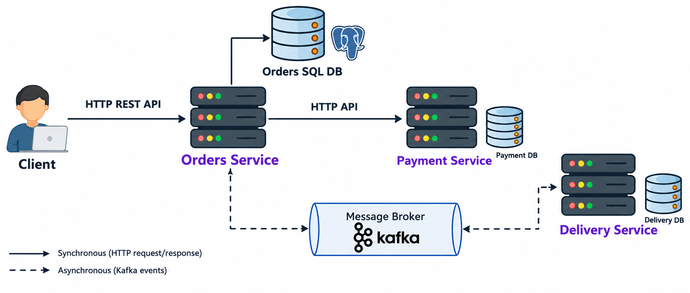

# Order Platform

A multi-module Java Spring Boot application demonstrating a microservices-style architecture for managing orders, payments, and deliveries.

## Architecture Overview



The project is structured as a Maven multi-module project, leveraging Spring Boot 4.x and Java 21. It consists of the following modules:

- **[`common-libs`](common-libs)**: Shared DTOs (Data Transfer Objects) and Kafka event models used across all services to ensure type safety and consistency.
- **[`order-service`](order-service)**: The primary entry point for order management. It handles order creation, tracks order status, and orchestrates the payment process.
- **[`payment-service`](payment-service)**: Responsible for processing payments. It provides a REST API for synchronous payment execution.
- **[`delivery-service`](delivery-service)**: Manages the delivery lifecycle. It listens for successful payment events and assigns couriers to orders.

### Infrastructure
- **PostgreSQL**: Used as the primary relational database for persisting orders, payments, and delivery records.
- **Apache Kafka**: Acts as the message broker for asynchronous, event-driven communication between services.

## Service Communication Patterns

The platform employs two primary communication patterns:

### 1. Synchronous HTTP (Request/Response)
Used when immediate confirmation is required.
- **Order Service -> Payment Service**: When a user initiates a payment for an order, the `order-service` calls the `payment-service` via a synchronous REST API using Spring's `HttpExchange` interface ([`PaymentHttpClient.java`](order-service/src/main/java/dev/udris/orderservice/external/PaymentHttpClient.java)).

### 2. Asynchronous Event-Driven (Pub/Sub)
Used for decoupled, reliable processing of downstream tasks.
- **Order Service -> Delivery Service**: Once a payment is successful, the `order-service` publishes an `OrderPaidEvent` to the `order-paid` Kafka topic. The `delivery-service` consumes this event to trigger courier assignment.
- **Delivery Service -> Order Service**: After a courier is assigned, the `delivery-service` publishes a `DeliveryAssignedEvent` to the `delivery-assigned` topic. The `order-service` consumes this to update the order status and provide the user with courier details and ETA.

## Getting Started

### Prerequisites
- Java 21
- Maven 3.9+
- Docker and Docker Compose

### 1. Start Infrastructure
Use Docker Compose to spin up PostgreSQL and Kafka:
```bash
docker-compose up -d
```

### 2. Build the Project
From the root directory, build all modules:
```bash
mvn clean install
```

### 3. Run the Services
You can run each service individually using the Spring Boot Maven plugin or by running the main classes in your IDE.

**Order Service:**
```bash
cd order-service && mvn spring-boot:run
```
**Payment Service:**
```bash
cd payment-service && mvn spring-boot:run
```
**Delivery Service:**
```bash
cd delivery-service && mvn spring-boot:run
```

### API Documentation
You can access the Swagger UI for each service at the following URLs:

- **Order Service**: [http://localhost:8080/swagger-ui.html](http://localhost:8080/swagger-ui.html)
- **Payment Service**: [http://localhost:8081/swagger-ui.html](http://localhost:8081/swagger-ui.html)

### Manual Testing (curl)
If you prefer using `curl`, you can use the following commands to test the order flow:

**1. Create an Order:**
```bash
curl -X POST http://localhost:8080/api/orders \
     -H "Content-Type: application/json" \
     -d '{
           "customerId": 1,
           "address": "Riga",
           "items": [
             {"itemId": 101, "quantity": 2, "itemName": "BigMac"},
             {"itemId": 102, "quantity": 2, "itemName": "Cola"},
             {"itemId": 103, "quantity": 3, "itemName": "Potato fries"},
           ]
         }' | jq
```

**2. Pay for an Order (e.g., Order ID 1):**
```bash
curl -X POST http://localhost:8080/api/orders/1/pay \
     -H "Content-Type: application/json" \
     -d '{
           "paymentMethod": "CARD"
         }' | jq
```

### 4. Example Workflow
1. **Create an Order**: POST to `order-service` at `/api/orders`.
2. **Pay for Order**: POST to `order-service` at `/api/orders/{id}/payment`.
3. **Check Status**: Observe the order status transition from `PENDING_PAYMENT` -> `PAID` -> `DELIVERY_ASSIGNED` as events flow through Kafka.
